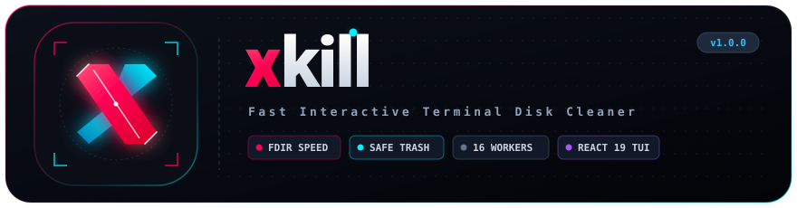

<p align="center">
      
    </p>

# xkill

Terminal UI tool to inspect and clean project dependencies, caches, temporary files, and empty directories.

---

## Features

- **Fast Directory Crawler:** Crawls directory trees using [`fdir`](https://github.com/thecodrr/fdir) with minimal memory overhead.
- **Bounded Concurrency Sizing:** Calculates directory sizes using partitioned queues (16 workers, 32 chunks) to prevent file descriptor exhaustion (`EMFILE`).
- **Target Presets:** Built-in profiles for common cleanup targets (`build-dirs`, `appdata`, `temp`, `dev-cache`).
- **Recycle Bin Soft Deletion (`--trash`):** Safely moves files and folders to the Windows Recycle Bin or OS trash instead of permanently deleting them.
- **Locked File Handling (`EBUSY` / `EPERM`):** Automatically detects locked files, marks them as `[LOCKED]`, and continues processing remaining items without crashing.
- **Empty Directory Cleaner (`--clean-empty`):** Scans and deletes empty directory trees left behind by uninstalled software or builds.
- **Age-Based Filtering (`--older-than`):** Filters targets by last modified time (e.g. `30d`, `24h`, `60m`) to prevent removing freshly generated caches.
- **Pattern Matching (`--pattern`):** Supports comma-separated glob patterns (`*.tmp`, `*.log`, `*.dmp`, `thumbs.db`).
- **Interactive TUI:** Terminal interface built with Ink and React 19, featuring keyboard navigation, responsive pagination, and real-time disk space tracking.

---

## Installation

### Run Directly

```bash
# npm
npx xkill

# pnpm
pnpm dlx xkill
```

### Global Install

```bash
# pnpm
pnpm add -g xkill

# npm
npm install -g xkill
```

---

## Usage

### Common Examples

```bash
# Scan current directory for common build and dependency folders
xkill

# Scan a specific directory or drive
xkill D:/Projects

# Clean AppData/Local safely (older than 14 days, send to Recycle Bin)
xkill --preset appdata --older-than 14d --trash

# Clean operating system temporary files older than 7 days
xkill --preset temp --older-than 7d --trash

# Clean package manager caches (npm, pnpm, yarn, pip)
xkill --preset dev-cache

# Find and clean empty directories
xkill ./projects --clean-empty

# Match specific file patterns
xkill C:/Users/YourUser/Downloads --pattern "*.tmp, *.log, *.dmp"

# Specify custom target directory names
xkill -t "coverage, .cache, out"

# Non-interactive batch removal (bypass prompts and force delete)
xkill --auto-remove --force
```

---

## Options

| Flag | Description | Example |
| :--- | :--- | :--- |
| `[path]` | Root directory path to scan (defaults to current directory) | `xkill D:/Workspaces` |
| `-p, --preset <name>` | Predefined target profile (`build-dirs`, `appdata`, `temp`, `dev-cache`) | `xkill -p appdata --trash` |
| `-t, --target <names>` | Target directory names to match (comma or space separated) | `xkill -t coverage, out, .turbo` |
| `--pattern <glob>` | File glob patterns to match (comma separated) | `xkill --pattern "*.log, *.tmp"` |
| `--clean-empty` | Scan and remove empty directories | `xkill ./projects --clean-empty` |
| `--older-than <time>` | Filter by last modified time (`s`, `m`, `h`, `d`, `w`) | `xkill -p temp --older-than 7d` |
| `--trash` | Move deleted items to Recycle Bin instead of permanent deletion | `xkill -p appdata --trash` |
| `-f, --force` | Bypass confirmation and attempt chmod unlock on read-only items | `xkill -f` |
| `-y, --auto-remove, --all` | Automatically select and delete all discovered targets | `xkill --auto-remove -f` |
| `--help` | Show CLI help text | `xkill --help` |
| `--version` | Show CLI version | `xkill --version` |

---

## Presets

| Preset | Target Paths / Patterns | Description |
| :--- | :--- | :--- |
| `build-dirs` (default) | `node_modules`, `.next`, `dist`, `build`, `target` | Standard project build outputs and dependencies |
| `appdata` | `%LOCALAPPDATA%` (`Temp`, `CrashDumps`, `logs`, `*.tmp`, `*.log`, `*.dmp`, `thumbs.db`) | Windows AppData caches, crash dumps, and residual logs |
| `temp` | `os.tmpdir()` (`Temp`, `tmp`, `*.tmp`, `*.log`, `*.dmp`) | Operating system temporary directories and files |
| `dev-cache` | `npm-cache`, `.pnpm-store`, `pip/cache`, `yarn/Cache` | Package manager global caches |

---

## Keybindings

| Key | Action |
| :--- | :--- |
| `Up` / `Down` | Move cursor up or down |
| `Space` | Toggle selection for current item |
| `a` | Select or deselect all items |
| `d` | Open deletion confirmation for selected items (or item under cursor) |
| `f` | Force delete immediately without confirmation prompt |
| `y` | Confirm deletion (or move to Recycle Bin if `--trash` is set) |
| `n` / `Esc` | Cancel deletion confirmation dialog |
| `q` / `Esc` | Exit application |

---

## Status Badges

| Badge | Meaning |
| :--- | :--- |
| `[EMPTY]` | Directory is empty (0 B, contains no child files) |
| `[deleting...]` | Asynchronous deletion in progress |
| `[DELETED]` | Successfully removed; freed size added to Saved total |
| `[LOCKED]` | Deletion failed because the item is locked by another process (`EBUSY` / `EPERM`) |
| `[ERROR]` | Deletion failed due to a system error (includes error code) |

---

## Project Structure

```
x-kill/
├── src/
│   ├── App.tsx          # Ink TUI interface (list view, badges, keybindings, delete flow)
│   ├── cli-parser.ts    # CLI flag tokenizer and duration parser
│   ├── delete-utils.ts  # Deletion logic (Recycle Bin trash vs fs.rm, file lock handling)
│   ├── fs-utils.ts      # Crawler (fdir), bounded concurrency sizing, glob matching
│   ├── index.tsx        # CLI entry point and meow configuration
│   └── presets.ts       # Preset configurations (appdata, temp, dev-cache, build-dirs)
├── tests/
│   ├── app.test.tsx     # TUI component tests (headers, prompts, locked badges, delegation)
│   ├── cli-args.test.ts # CLI parser and duration tests
│   ├── delete-utils.test.ts # Deletion, soft-delete, and EBUSY error simulation tests
│   ├── fs-utils.test.ts # fdir crawler, size calculation, pattern matching tests
│   └── presets.test.ts  # Preset resolution tests
├── dist/                # Compiled ES Module output
├── package.json
└── tsconfig.json
```

---

## Development

```bash
# Install dependencies
pnpm install

# Start development mode
pnpm dev

# Run test suite (Vitest)
pnpm test

# Build TypeScript to ES Module
pnpm run build
```

---

## License

MIT © HuyPaul
